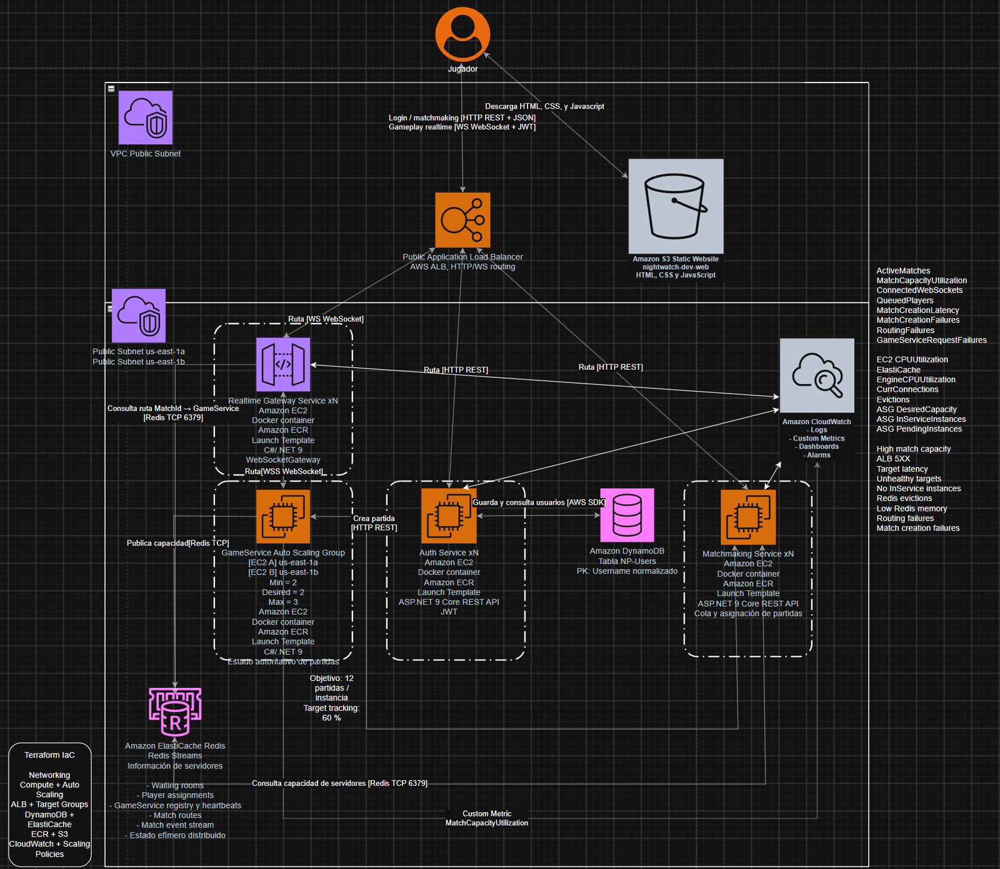
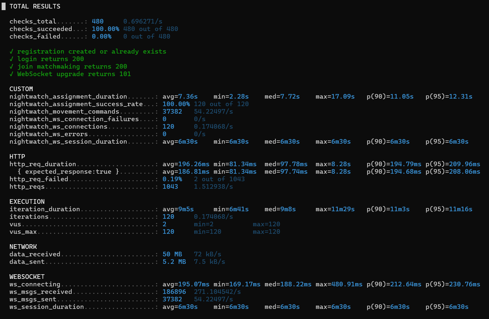
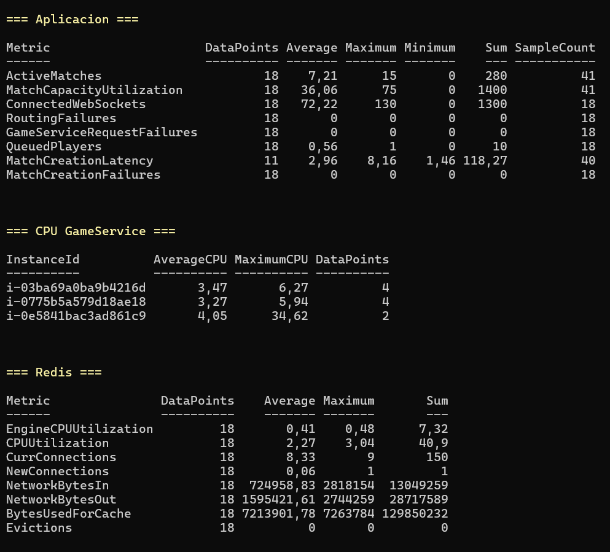
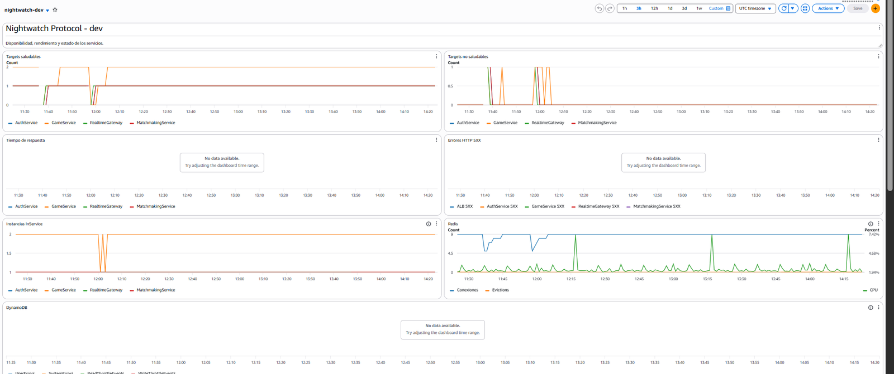
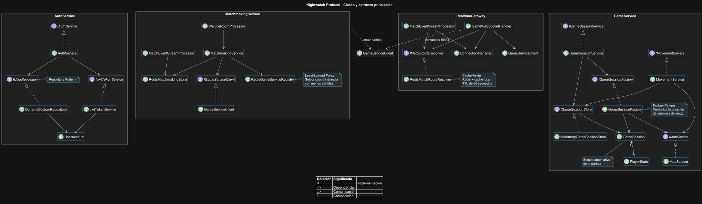

# 🌙 Nightwatch Protocol

> A real-time asymmetric multiplayer horror game on a server-authoritative, cloud-deployed microservice backend, with no player acting as host.

One player is the **night guard**, stuck in an office managing cameras and doors. The other players are **animatronics** that roam the map, collect items to power up and try to reach the guard. The guard wins by surviving the night (12 AM → 6 AM).

Built for a Software Architecture course, with a focus on **concurrency, real-time synchronization and horizontal scalability**.

<!-- Add a GIF/screenshots here: login → lobby → match. It is the most valuable thing for a portfolio. -->

## What was built

- **5 repositories**, 4 C#/.NET microservices + a Unity 6 client + Terraform infrastructure
- **Server-authoritative gameplay:** clients send *intentions*; the Game Service validates them against map collisions, roles and door state, and emits the official events
- **Many matches in parallel:** one Game Service instance hosts multiple matches; matchmaking picks an instance with free capacity
- **Real-time sync over WebSockets** through a gateway that holds no game logic
- **Event-driven match lifecycle** with Redis Streams (match finished events consumed by Matchmaking and the Gateway)
- **Cloud deployment on AWS** defined in Terraform: VPC, ALB with path routing, one Auto Scaling Group per service with CPU target tracking, ElastiCache Redis, DynamoDB, ECR, CloudWatch alarms and a Unity WebGL build on S3
- **Operational metrics** published by every service to CloudWatch
- **CI** with GitHub Actions on every service (restore, build, test)

## Player journey

Register → log in → join a waiting room **or** create one and invite friends with an invite code → countdown → match starts → synchronized play (player movement, doors, collectible pickup, security cameras, other players) → a shared match clock runs from 12 AM to 6 AM for everyone → the match ends and the result is published as an event.

## Architecture

```
                 HTTP                                   ┌────────────────────┐
Unity Client ───────────► Auth Service ──────────────►  │ DynamoDB (users)   │
     │       ───────────► Matchmaking Service ─┐        └────────────────────┘
     │                          │ HTTP         │ Redis (rooms/queue, game-instance registry)
     │ WebSocket + JWT          ▼              │
     └──────────► Realtime Gateway ─HTTP─► Game Service (in-memory authoritative state)
                        ▲                      │
                        └──── Redis Streams ◄──┘  (match-finished events)

All services ──► CloudWatch (custom metrics)      Behind one public ALB: /auth /matchmaking /game-ws
```


| Component | Responsibility | Repository |
|---|---|---|
| Unity Client | Login/lobby/game UI, rendering, input, WebSocket client | [Nightwatch-Protocol-Unity-Client](https://github.com/JuanDeRe/Nightwatch-Protocol-Unity-Client) |
| Auth Service | Register/login, password hashing, JWT issuing (DynamoDB) | [NP-AuthService](https://github.com/JuanDeRe/NP-AuthService) |
| Matchmaking Service | Queue, waiting rooms, invite codes, role assignment, match creation | [NP-MatchmakingService](https://github.com/JuanDeRe/NP-MatchmakingService) |
| Realtime Gateway | JWT-authenticated WebSockets, command routing, event fan-out | [NP-RealtimeGateway](https://github.com/JuanDeRe/NP-RealtimeGateway) |
| Game Service | Authoritative match state, rules, match timer | [NP-GameService](https://github.com/JuanDeRe/NP-GameService) |
| Infrastructure | AWS provisioning with Terraform | [NP-Terraform](https://github.com/JuanDeRe/NP-Terraform) |

### Design decisions
- **Authoritative server:** movement is normalized, speed-capped server-side and checked against the walkable map and closed doors.
- **Thin gateway:** it validates the JWT and that the player belongs to the match, then forwards; rules live in one place.
- **Dynamic capacity-aware placement:** Game Service instances send heartbeats with capacity to Redis; Matchmaking uses them to place new matches.
- **Durable events:** match results go through a Redis Stream so slow or restarting consumers do not lose them.

## Tech stack
C# · .NET 9 · ASP.NET Core · Unity 6 · WebSockets · Redis (StackExchange.Redis, Streams) · DynamoDB · Docker · AWS (EC2 ASG, ALB, ECR, ElastiCache, CloudWatch, S3) · Terraform · GitHub Actions · xUnit

## Architecture (as deployed on AWS)



## Results

Load test with **k6**: 120 virtual players doing the full flow (register → login → matchmaking → WebSocket → movement) on **2 Game Service instances**.

| Indicator | Result |
|---|---|
| Players connected over WebSocket | 118 / 120, 0 connection failures, 0 WebSocket errors |
| Successful joins / assignments | 119 / 120 · 118 / 119 |
| HTTP p95 latency | **177 ms** (target < 1,000 ms) |
| Match assignment p95 | 13 s (target < 60 s) |
| Movement commands sent | 36,600 |
| Messages broadcast to clients | 182,349 |
| Peak matches per instance | 12 (60 % capacity utilization) |
| Game Service CPU | ~3 % average, ~6 % peak |
| Routing / match-creation failures | 0 / 0 |

**4 of 4 quality gates passed** (checks > 95 %, HTTP failures < 1 %, HTTP p95 < 1 s, assignment p95 < 60 s).

<p>
  
  
</p>

### Observability
Every service publishes custom metrics to CloudWatch (active matches, capacity utilization, connected WebSockets, queue size, match-creation latency, routing failures), with a dashboard and alarms defined in Terraform.



## Design patterns

| Pattern | Where | Purpose |
|---|---|---|
| Factory | `GameSessionFactory` | Consistent match creation |
| Repository | `IUserRepository`, `IGameSessionStore` | Persistence abstraction |
| Dependency inversion | Service and client interfaces | Decoupling and testability |
| Cache-aside | `RedisMatchRouteResolver` | Fewer Redis lookups per message |
| Gateway | Realtime Gateway | One place for WebSocket, JWT and routing |
| Event-driven | Redis Streams | Match lifecycle events |
| Background worker | Processors and publishers | Decoupled periodic work |
| Least-loaded placement | Matchmaking | Spread matches across Game Services |



## Trade-offs and future work
- **Trade-offs:** two base Game Service instances raise cost but reduce peak risk · scale-out takes ~5 min · Matchmaking uses synchronous Redis calls · Gateway has limited test coverage · the environment uses HTTP/WS without TLS
- **Next:** async Redis operations · separate stream consumers · faster EC2 start-up · more Gateway tests · HTTPS/WSS · private subnets for compute · validate capacity with 3 instances

## Project status

| Area | Status |
|---|---|
| Auth, matchmaking (queue, rooms, invite codes), gateway, game service | ✅ |
| Sync of movement, doors, collectibles, cameras, match clock | ✅ |
| Animatronic win by reaching the office | ✅ |
| AWS deployment with autoscaling and CloudWatch metrics | ✅ |
| Battery/power system | ⚠️ UI placeholder only |
| Animatronic abilities beyond collect-and-power-up (flash, shock, camera sabotage, shadow mode…) | ⚠️ Partial: data model only |
| Dedicated observability service / dashboard | 📐 Designed; replaced by CloudWatch metrics |

## Documentation
Design docs (context, architecture, quality scenarios, MoSCoW, deployment) are in [`/docs`](./docs).

## Author
**Juan David Roa Hernández**
